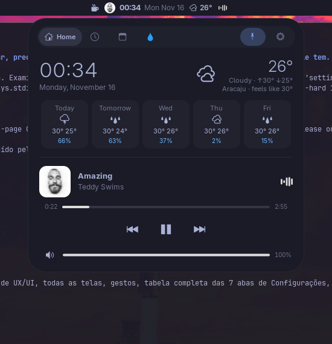
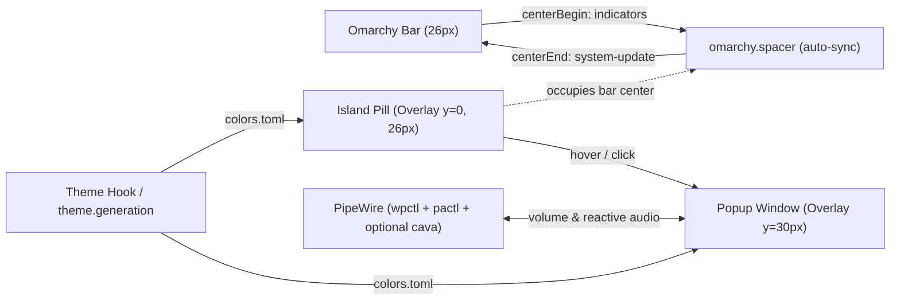
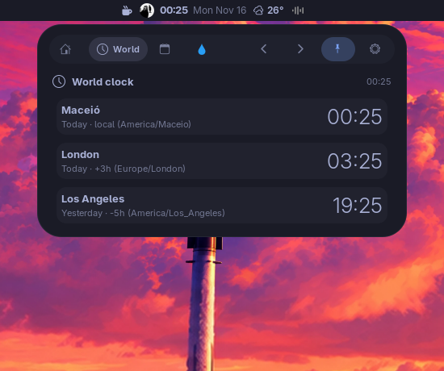
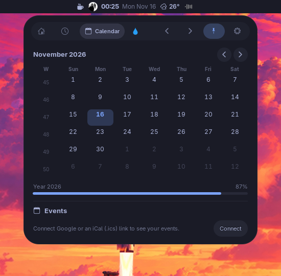
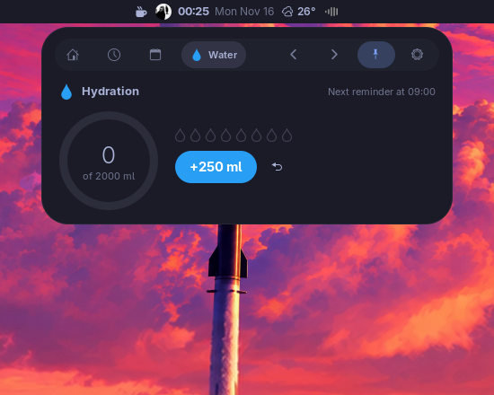
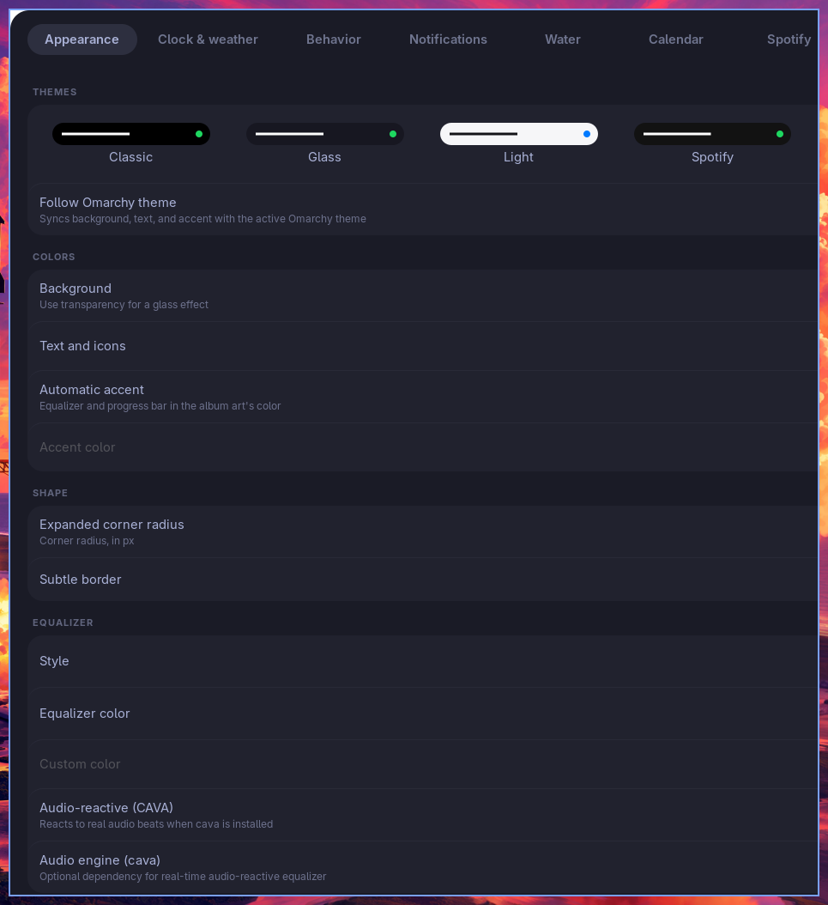

<div align="center">

# omarchy-island

[Português](README.md) | **English** | [Español](README.es.md)

**Native Dynamic Island for Omarchy (Hyprland + Wayland).**

Based on [linux-island](https://github.com/mrlazarias/linux-island) by Murilo Azarias, redesigned to blend into Omarchy's 26px top bar, open as a floating panel below the bar, run across multiple monitors, and sync automatically with system themes and audio.


*Compact mode at `y = 0` (26px), integrated directly into the bar next to `omarchy.indicators`.*



*Expanded panel below the bar (`y = 30px`) keeping the clock, album art, weather, and equalizer visible in the bar.*

</div>

---

## 🎨 Design & Architecture

`omarchy-island` is built to behave like a native `omarchy-shell` module without modifying any packaged files under `/usr/share/omarchy/`.



### UX/UI Choices
- **Two independent `gtk-layer-shell` windows:** the bar pill (`y = 0`, 26px, borderless) and the expanded panel (`y = 30px`, rounded corners) are separate surfaces. Opening the panel keeps the clock pill visible in the bar (just like the stock `omarchy.clock`).
- **Dynamic bar spacer (`omarchy.spacer`):** whenever the compact pill width changes (music playing/stopped, date or weather toggled), the island automatically updates `omarchy.spacer` in `~/.config/omarchy/shell.json`, keeping `centerBegin` icons snug next to the clock.
- **Fixed top navigation bar:** tabs (**Home**, **World**, **Calendar**, **Water**), `<` / `>` arrows, **Pin open** toggle, and **Settings** shortcut stay in the exact same spot at the top of the popup regardless of page height.
- **Doesn't close on inner clicks:** clicking empty space inside the open panel will not close it accidentally; it closes when moving the pointer away (900 ms grace delay), clicking the bar pill, or unpinning.
- **Multi-monitor sync:** spawns one anchored instance per connected monitor (`monitor-added` / `monitor-removed`), sharing player, volume, weather, calendar, and hydration state.
- **Live Omarchy theme sync:** reads `background`, `foreground`, and `accent` from the active theme's `colors.toml` and updates live via `Gio.FileMonitor` on `theme.generation` + `theme-set.d` hook.

---

## ✨ Features

### 1. Home: Clock, 5-Day Weather & Media Player
- **Clock & date:** 24h or 12h format, full localized date in **English, Português, and Español** (`i18n`).
- **Weather & 5-day forecast:** current temperature, feels-like, daily min/max, and rain probability via [Open-Meteo](https://open-meteo.com/), with automatic IP detection ([ipwho.is](https://ipwho.is/)) or a fixed city.
- **Media (MPRIS):** works with Spotify, YouTube Music / YouTube in browsers (Chrome, Firefox, Brave…), VLC, mpv, Rhythmbox, etc.
  - **Browser track changes:** detects delayed `mpris:artUrl` updates so album art updates properly instead of sticking to the generic browser icon.
  - **Real system volume via PipeWire (`wpctl`) + live sync (`pactl subscribe`):** since browsers expose MPRIS volume as read-only, mouse-wheel scrolling, slider, and mute control `@DEFAULT_AUDIO_SINK@` and stay synced in real time with media keys and `omarchy.audio`.
  - **Spotify Web API (optional):** also shows the active playlist and remote playback device (phone, speaker, TV).
- **Configurable Equalizer:**
  - **Styles:** *Bars* (4 classic bars), *Symmetric* (5 center-mirrored bars), *Wave* (continuous flowing curve), *Dots* (3 pulsing dots), or *Off*.
  - **Colors:** *Theme color* (default), *Album art color*, *Font color*, or *Custom*.
  - **Real-time audio-reactive (optional CAVA):** when `cava` is installed, a single shared process reads live PipeWire frequencies while music is playing; falls back to smooth animation with zero extra dependencies if not installed.

### 2. World Clock (`World`)



- Displays configurable cities and time zones (`Name|Continent/City`, e.g. `Maceió|America/Maceio, London|Europe/London, Los Angeles|America/Los_Angeles`).
- Shows current time, relative day (*Today*, *Tomorrow*, *Yesterday*), and offset (`local`, `+3h`, `-5h`) following the island's language.
- **Configurable display:** *On home page and own page*, *Only on own page*, *Only on home page*, or *Off*.

### 3. Local Calendar, iCal (`.ics`) & Google Calendar (`Calendar`)



- **Local calendar with no account required:** fixed 6×7 monthly grid with **ISO week numbers**, month stepping, *Today* button, **Year progress** bar, and **Life progress** bar (matching `omarchy.clock` preferences: week start, birth year, and life expectancy).
- **iCal (`.ics`) link without Google Cloud:** paste the secret iCal URL from Google Calendar, Outlook, iCloud, or Nextcloud in Settings — validated (`https://` / `webcal://`) and stored in the system keyring (`libsecret`), strictly read-only.
- **Google Calendar (optional OAuth):** still supported if you place desktop OAuth credentials at `~/.config/linux-island/google_client_secret.json`.
- **Meeting alerts:** countdown in the compact pill with optional sound and a **Join** button for Google Meet, Zoom, or Teams links.

  

### 4. Hydration (`Water`) & Notifications



- **Hydration:** configurable daily goal (ml), glass size, interval, active hours, snooze, sound alert, and automatic midnight reset.
- **Notifications:** disabled by default on Omarchy so they don't duplicate `omarchy-notifications`; can be enabled in Settings with queue support, *Do not disturb*, privacy mode (title-only), and ignored apps list.

  

### 5. Live Settings



All changes apply and save live automatically (and flush immediately when closing the window). Includes a one-click **Install cava** button under **Appearance → Equalizer** via `pkexec`.

---

## 🖱️ Gestures & Controls

| Action | Result |
|---|---|
| Hover the bar pill | opens the panel below the bar |
| Click the bar pill | toggles open / closed |
| Click **Pin open** | keeps the panel open when moving the pointer away |
| Click tabs / `<` `>` / swipe | switches between *Home*, *World*, *Calendar*, and *Water* |
| Scroll mouse wheel | adjusts volume (MPRIS or PipeWire) |
| Middle-click | play / pause |
| Right-click | opens menu: Settings, open player, Quit |

---

## 🚀 Installation on Omarchy (Arch Linux)

```bash
sudo pacman -S python-gobject gtk3 gtk-layer-shell python-cairo
git clone https://github.com/iurynathan/omarchy-island.git ~/projects/omarchy-island
cd ~/projects/omarchy-island
./install-omarchy.sh
./run.sh &
```

*(Optional: for real-time audio-reactive equalizer, click **Install cava** in Settings → Appearance → Equalizer, or run `sudo pacman -S cava`.)*

### What `./install-omarchy.sh` does
1. Installs the `theme-set` hook via `omarchy hook install theme-set`.
2. Backs up and updates `~/.config/omarchy/shell.json` (keeps `omarchy.indicators` in `centerBegin`, places `omarchy.spacer` in `center`, and removes `omarchy.clock`, `omarchy.weather`, and `omarchy.elsewhen`).
3. Backs up and registers autostart in `~/.config/hypr/autostart.lua`.

### Manual install (Ubuntu, Pop!_OS, or Debian)

```bash
sudo apt install python3-gi python3-gi-cairo gir1.2-gtk-3.0 gir1.2-gtklayershell-0.1
git clone https://github.com/iurynathan/omarchy-island.git
cd omarchy-island
./run.sh
```

---

## ⚙️ Settings Tabs & CLI

| Tab | What you configure |
|---|---|
| **Appearance** | presets, **Follow Omarchy theme**, colors, corner radius, border, **Equalizer** (style, color, audio-reactive, and `cava` installer) |
| **Clock & weather** | 12h/24h, date in pill, **World clock** (display mode and cities/timezones), weather city, and °C / °F |
| **Behavior** | hover expand, new-track peek, scroll volume, ignored players, top margin, **Sync bar spacer**, language, and autostart |
| **Notifications** | enable/disable in pill, do not disturb, duration, hide body text, ignored apps |
| **Water** | daily goal, glass size, interval, active hours, snooze, sound, and system notification |
| **Calendar** | **Local calendar** (start of week, birth year, life expectancy), **iCal (.ics) link**, Google OAuth, days ahead, and meeting alerts |
| **Spotify** | connect account to display playlist and playback device |

### CLI Flags

- `./run.sh --settings` (`-s`): opens the settings window.
- `./run.sh --page <home|world|agenda|water>`: opens and pins a specific page (great for Hyprland keybindings).
- `./run.sh --reload-theme`: syncs the active Omarchy theme immediately.
- `./run.sh --restart` (`-r`): restarts the island (useful after switching language).
- `./run.sh --city "City"` / `./run.sh --margin PX`: temporary overrides for the current run.

---

## 🔒 Privacy & License

- **Local-first:** hydration, local calendar, and settings stay in `~/.config/linux-island/` and `~/.local/state/linux-island/`.
- **Protected secrets:** iCal `.ics` URL, Google tokens, and Spotify credentials are stored in the **system keyring** (`libsecret`, `0600` file fallback), never in plain-text `config.json`.
- **Read-only:** calendar (iCal / Google) and Spotify integrations never modify your account data.
- **License:** [MIT](LICENSE) — based on the original work by Murilo Azarias (`mrlazarias/linux-island`).
