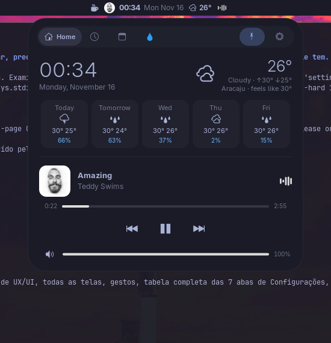
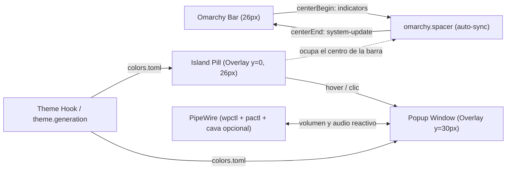
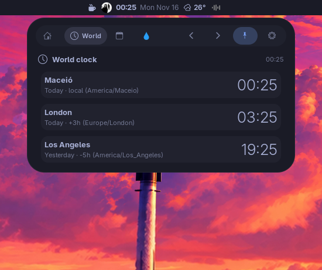
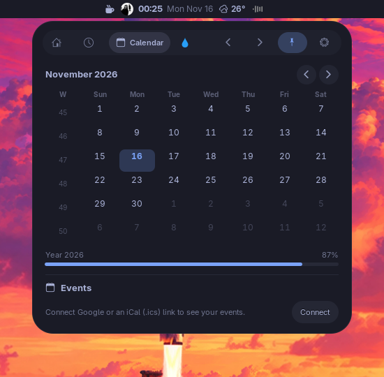
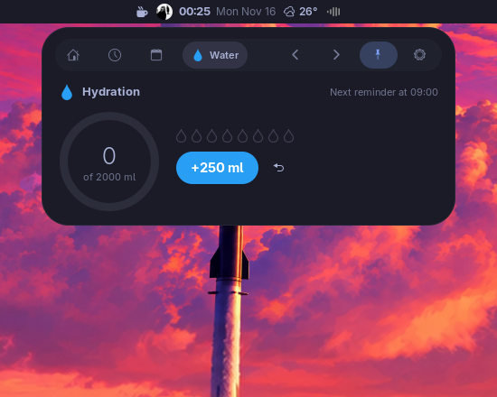
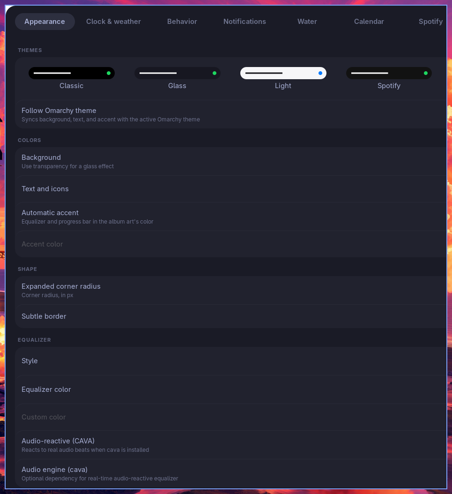

<div align="center">

# omarchy-island

[Português](README.md) | [English](README.en.md) | **Español**

**Dynamic Island nativa para Omarchy (Hyprland + Wayland).**

Basado en [linux-island](https://github.com/mrlazarias/linux-island) de Murilo Azarias, rediseñado para integrarse en la barra de 26px de Omarchy, abrirse como un panel flotante debajo de la barra, funcionar en múltiples monitores y sincronizarse automáticamente con los temas y el audio del sistema.


*Modo compacto en `y = 0` (26px), integrado directamente en la barra junto a `omarchy.indicators`.*



*Panel abierto debajo de la barra (`y = 30px`) manteniendo el reloj, la portada, el clima y el ecualizador visibles en la barra.*

</div>

---

## 🎨 Diseño y Arquitectura

`omarchy-island` está diseñado para comportarse como un módulo nativo de `omarchy-shell` sin modificar ningún archivo empaquetado en `/usr/share/omarchy/`.



### Decisiones de UX/UI
- **Dos ventanas `gtk-layer-shell` independientes:** la píldora de la barra (`y = 0`, 26px, sin borde) y el panel expandido (`y = 30px`, esquinas redondeadas) son superficies separadas. Al abrir el panel, el reloj sigue visible en la barra (igual que el `omarchy.clock` original).
- **Espaciador dinámico (`omarchy.spacer`):** cada vez que cambia el ancho de la píldora compacta (música sonando/pausada, fecha o clima activados/desactivados), la isla ajusta automáticamente el tamaño de `omarchy.spacer` en `~/.config/omarchy/shell.json`, manteniendo los iconos de `centerBegin` pegados al reloj.
- **Barra de navegación fija arriba:** las pestañas (**Inicio**, **Mundo**, **Agenda**, **Agua**), el botón **Fijar abierta** (*Pin*) y el acceso a **Ajustes** permanecen siempre en el mismo sitio en la parte superior del panel, sin importar la altura de cada página.
- **No se cierra al hacer clic dentro:** hacer clic en zonas libres del panel no lo cierra por accidente; se cierra al apartar el ratón (margen de 900 ms), al hacer clic en la píldora de la barra o al desfijar el Pin.
- **Multi-monitor sincronizado:** crea una instancia anclada en cada monitor conectado (`monitor-added` / `monitor-removed`), compartiendo reproductor, volumen, clima, agenda e hidratación.
- **Tema vivo de Omarchy:** lee `background`, `foreground` y `accent` del `colors.toml` del tema activo y se actualiza al instante mediante `Gio.FileMonitor` en `theme.generation` + hook `theme-set.d`.

---

## ✨ Funcionalidades

### 1. Inicio: Reloj, Clima de 5 días y Reproductor
- **Reloj y fecha:** formato 24h o 12h, fecha completa e idioma en **Español, Português e English** (`i18n`).
- **Clima y pronóstico de 5 días:** temperatura actual, sensación térmica, mínima/máxima y probabilidad de lluvia vía [Open-Meteo](https://open-meteo.com/), con detección automática por IP ([ipwho.is](https://ipwho.is/)) o ciudad manual.
- **Música (MPRIS):** compatible con Spotify, YouTube Music / YouTube en navegador (Chrome, Firefox, Brave…), VLC, mpv, Rhythmbox, etc.
  - **Cambio de pista en navegadores:** detecta actualizaciones tardías de `mpris:artUrl` para actualizar la portada en lugar de quedarse con el icono genérico del navegador.
  - **Volumen real vía PipeWire (`wpctl`) + sincronización (`pactl subscribe`):** como los navegadores exponen el volumen MPRIS como solo lectura, la rueda del ratón, el deslizador y el botón de silencio controlan `@DEFAULT_AUDIO_SINK@` y se sincronizan en tiempo real con teclas multimedia y `omarchy.audio`.
  - **Spotify Web API (opcional):** muestra además la playlist actual y el dispositivo remoto (móvil, altavoz, TV).
- **Ecualizador configurable:**
  - **Estilos:** *Barras* (4 barras clásicas), *Simétrico* (5 barras centradas estilo Dynamic Island), *Onda* (curva continua), *Puntos* (3 puntos pulsantes) o *Desactivado*.
  - **Colores:** *Color del tema* (predeterminado), *Color de la portada*, *Color de la fuente* o *Personalizado*.
  - **Reactivo al audio real (CAVA opcional):** si `cava` está instalado, un único proceso compartido lee las frecuencias reales de PipeWire mientras suena música; si no está instalado, usa una animación fluida sin dependencias extra.

### 2. Reloj Mundial (`Mundo`)



- Muestra múltiples ciudades y zonas horarias (`Nombre|Continente/Ciudad`, ej.: `Maceió|America/Maceio, London|Europe/London, Los Angeles|America/Los_Angeles`).
- Indica la hora actual, el día relativo (*Hoy*, *Mañana*, *Ayer*) y la diferencia horaria (`local`, `+3h`, `-5h`) según el idioma de la isla.
- **Visualización configurable:** *En la página inicial y en página propia*, *Solo en página propia*, *Solo en la página inicial* o *Desactivado*.

### 3. Calendario Local, iCal (`.ics`) y Google Calendar (`Agenda`)



- **Calendario local sin cuenta:** cuadrícula mensual fija (6×7) con **números de semana ISO**, navegación entre meses, botón *Hoy*, barra de **progreso del año** y **progreso de vida** (con las mismas preferencias de `omarchy.clock`: inicio de semana, año de nacimiento y esperanza de vida).
- **Enlace iCal (`.ics`) sin Google Cloud:** pega la URL secreta iCal de Google Calendar, Outlook, iCloud o Nextcloud en Ajustes — validada (`https://` / `webcal://`) y guardada en el llavero del sistema (`libsecret`), 100% solo lectura.
- **Google Calendar (OAuth opcional):** soporte mantenido para credenciales de escritorio en `~/.config/linux-island/google_client_secret.json`.
- **Avisos de reunión:** cuenta regresiva en la píldora con sonido opcional y botón **Unirse** para enlaces de Google Meet, Zoom o Teams.

  

### 4. Hidratación (`Agua`) y Notificaciones



- **Hidratación:** meta diaria en ml, tamaño del vaso, intervalo, horario activo, posponer, sonido y reinicio automático a medianoche.
- **Notificaciones:** desactivadas por defecto en Omarchy para no duplicar `omarchy-notifications`; activables en Ajustes con cola, *No molestar*, modo privado (solo título) y lista de apps ignoradas.

  

### 5. Ajustes en vivo



Todos los cambios se aplican y guardan automáticamente al instante (y se confirman al cerrar la ventana). Incluye el botón **Instalar cava** en **Apariencia → Ecualizador** para instalar la dependencia opcional vía `pkexec`.

---

## 🖱️ Gestos y Controles

| Acción | Resultado |
|---|---|
| Pasar el ratón por la píldora | abre el panel debajo de la barra |
| Clic en la píldora de la barra | alterna abrir / cerrar |
| Clic en **Fijar abierta** (Pin) | mantiene el panel abierto al apartar el ratón |
| Clic en pestañas / deslizar | cambia entre *Inicio*, *Mundo*, *Agenda* y *Agua* |
| Girar la rueda del ratón | ajusta el volumen (MPRIS o PipeWire) |
| Clic con botón central | play / pausa |
| Clic derecho | menú: Ajustes, abrir reproductor, Salir |

---

## 🚀 Instalación en Omarchy (Arch Linux)

```bash
sudo pacman -S python-gobject gtk3 gtk-layer-shell python-cairo
git clone https://github.com/iurynathan/omarchy-island.git ~/projects/omarchy-island
cd ~/projects/omarchy-island
./install-omarchy.sh
./run.sh &
```

*(Opcional: para ecualizador reactivo al audio real, pulsa **Instalar cava** en Ajustes → Apariencia → Ecualizador, o ejecuta `sudo pacman -S cava`.)*

### Qué hace `./install-omarchy.sh`
1. Instala el hook `theme-set` mediante `omarchy hook install theme-set`.
2. Respalda y actualiza `~/.config/omarchy/shell.json` (mantiene `omarchy.indicators` en `centerBegin`, añade `omarchy.spacer` en `center` y elimina `omarchy.clock`, `omarchy.weather` y `omarchy.elsewhen`).
3. Respalda y registra el autoarranque en `~/.config/hypr/autostart.lua`.

### Instalación manual (Ubuntu, Pop!_OS o Debian)

```bash
sudo apt install python3-gi python3-gi-cairo gir1.2-gtk-3.0 gir1.2-gtklayershell-0.1
git clone https://github.com/iurynathan/omarchy-island.git
cd omarchy-island
./run.sh
```

---

## ⚙️ Pestañas de Ajustes y CLI

| Pestaña | Qué puedes configurar |
|---|---|
| **Apariencia** | temas predefinidos, **Seguir tema de Omarchy**, colores, redondeo, borde, **Ecualizador** (estilo, color, reactivo al audio e instalador de `cava`) |
| **Reloj y clima** | 12h/24h, fecha en la píldora, **Reloj mundial** (modo y ciudades/zonas), ciudad del clima y °C / °F |
| **Comportamiento** | hover, mostrar canción nueva, volumen con rueda, reproductores ignorados, distancia superior, **Ajustar espaciador**, idioma y autoarranque |
| **Notificaciones** | activar/desactivar en píldora, no molestar, duración, ocultar texto, apps ignoradas |
| **Agua** | meta diaria, tamaño del vaso, intervalo, horario, posponer, sonido y notificación del sistema |
| **Agenda** | **Calendario local** (inicio de semana, año de nacimiento, esperanza de vida), **Enlace iCal (.ics)**, Cuenta Google OAuth, días adelante y avisos |
| **Spotify** | conectar cuenta para mostrar playlist y dispositivo |

### Opciones CLI

- `./run.sh --settings` (`-s`): abre la ventana de ajustes.
- `./run.sh --page <home|world|agenda|water>`: abre y fija una página específica (ideal para atajos en Hyprland).
- `./run.sh --reload-theme`: sincroniza el tema de Omarchy al instante.
- `./run.sh --restart` (`-r`): reinicia la isla (útil tras cambiar el idioma).
- `./run.sh --city "Ciudad"` / `./run.sh --margin PX`: valores temporales para la ejecución actual.

---

## 🔒 Privacidad y Licencia

- **Todo local:** hidratación, calendario local y ajustes permanecen en `~/.config/linux-island/` y `~/.local/state/linux-island/`.
- **Secretos protegidos:** la URL `.ics` y los tokens de Google/Spotify se guardan en el **llavero del sistema** (`libsecret`, respaldo `0600`), nunca en texto plano en `config.json`.
- **Solo lectura:** las integraciones de agenda (iCal / Google) y Spotify no modifican datos de tu cuenta.
- **Licencia:** [MIT](LICENSE) — basado en el trabajo original de Murilo Azarias (`mrlazarias/linux-island`).
