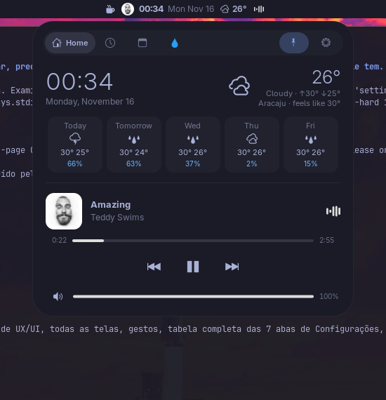
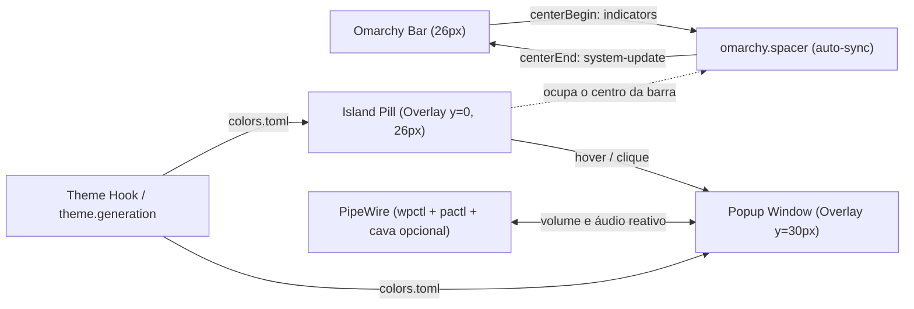
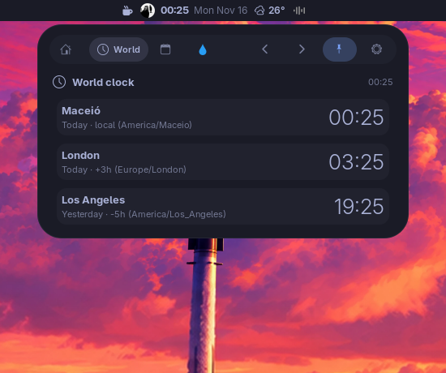
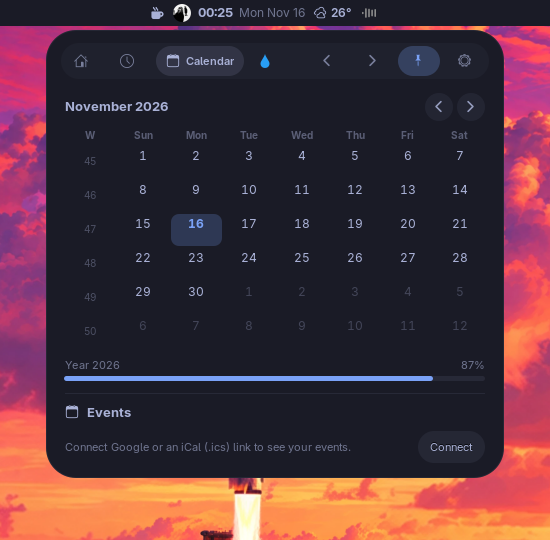
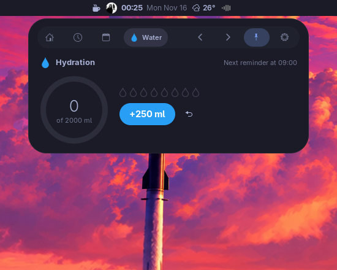
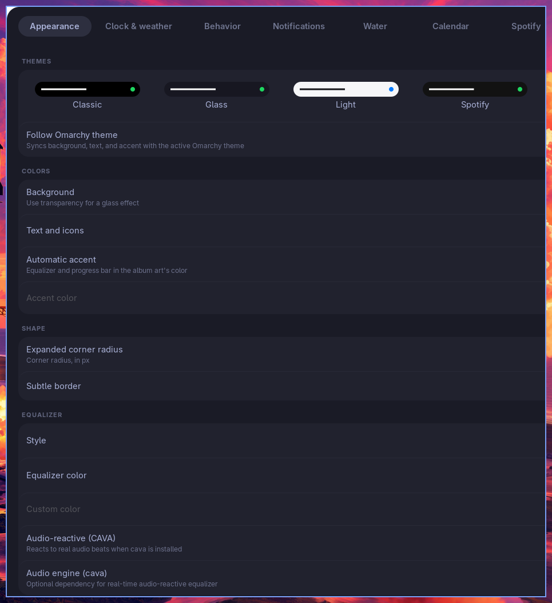

<div align="center">

# omarchy-island

**Português** | [English](README.en.md) | [Español](README.es.md)

**Dynamic Island nativa para o Omarchy (Hyprland + Wayland).**

Baseado no [linux-island](https://github.com/mrlazarias/linux-island) de Murilo Azarias, redesenhado para se fundir à barra de 26px do Omarchy, abrir como um painel flutuante abaixo da barra, rodar em múltiplos monitores e sincronizar automaticamente com os temas e o áudio do sistema.


*Modo compacto em `y = 0` (26px), integrado diretamente à barra ao lado do `omarchy.indicators`.*



*Painel aberto abaixo da barra (`y = 30px`) mantendo relógio, capa, clima e equalizador visíveis na barra.*

</div>

---

## 🎨 Design e Arquitetura

O `omarchy-island` foi construído para se comportar como parte nativa do `omarchy-shell` sem alterar nenhum arquivo empacotado em `/usr/share/omarchy/`.



### Escolhas de UX/UI
- **Duas janelas `gtk-layer-shell` independentes:** a pílula da barra (`y = 0`, 26px, sem borda) e o painel expandido (`y = 30px`, cantos arredondados) são superfícies separadas. Ao abrir o painel, a pílula continua visível na barra (assim como o `omarchy.clock` original).
- **Espaçador dinâmico (`omarchy.spacer`):** sempre que a largura da pílula compacta muda (música tocando/parando, data ou clima ligados/desligados), a ilha ajusta automaticamente o tamanho de `omarchy.spacer` no `~/.config/omarchy/shell.json`, mantendo os ícones de `centerBegin` colados ao relógio.
- **Barra de navegação fixa no topo:** abas (**Início**, **Mundo**, **Agenda**, **Água**), botão **Fixar aberta** (*Pin*) e atalho de **Configurações** ficam sempre no mesmo lugar no topo do painel, mesmo quando cada aba tem altura diferente.
- **Não fecha ao clicar dentro:** clicar em áreas livres do painel não fecha a ilha acidentalmente; ela fecha ao tirar o mouse (com tolerância de 900 ms) ou ao clicar na pílula da barra / desafixar o Pin.
- **Multi-monitor sincronizado:** cria uma instância ancorada em cada monitor conectado (`monitor-added` / `monitor-removed`), compartilhando player, volume, clima, agenda e hidratação.
- **Tema vivo do Omarchy:** lê `background`, `foreground` e `accent` do `colors.toml` do tema ativo e atualiza ao vivo via `Gio.FileMonitor` em `theme.generation` + hook `theme-set.d`.

---

## ✨ Funcionalidades

### 1. Início: Relógio, Clima e Player de Mídia
- **Relógio e data:** formato 24h ou 12h, data por extenso e suporte completo a **Português, English e Español** (`i18n`).
- **Clima e previsão de 5 dias:** temperatura atual, sensação térmica, mínima/máxima e chance de chuva via [Open-Meteo](https://open-meteo.com/), com detecção automática por IP ([ipwho.is](https://ipwho.is/)) ou cidade manual.
- **Mídia (MPRIS):** funciona com Spotify, YouTube Music / YouTube no navegador (Chrome, Firefox, Brave…), VLC, mpv, Rhythmbox, entre outros.
  - **Troca de faixa em navegadores:** detecta atualizações tardias de `mpris:artUrl` para não ficar preso no ícone genérico do navegador.
  - **Volume real via PipeWire (`wpctl`) + sync (`pactl subscribe`):** como navegadores expõem o volume MPRIS como somente leitura, a rolagem do mouse, o slider e o botão de mudo controlam o sink padrão do sistema (`@DEFAULT_AUDIO_SINK@`) e refletem alterações externas (teclas de volume, `omarchy.audio`) instantaneamente.
  - **Spotify Web API (opcional):** exibe também a playlist ativa e o dispositivo remoto (celular, caixa de som, TV).
- **Equalizador configurável:**
  - **Estilos:** *Barras* (4 barras clássicas), *Simétrico* (5 barras espelhadas estilo Dynamic Island), *Onda* (curva contínua), *Pontos* (3 pontos pulsantes) ou *Desativado*.
  - **Cores:** *Cor do tema* (padrão), *Cor da capa do álbum*, *Cor da fonte* ou *Personalizada*.
  - **Reativo ao áudio real (CAVA opcional):** quando o `cava` está instalado, um único processo compartilhado lê as frequências reais do PipeWire enquanto há música tocando. Se não estiver instalado, usa animação suave sem dependências extras.

### 2. Horário Mundial (`Mundo`)



- Lista cidades e fusos horários configuráveis (`Nome|Continente/Cidade`, ex.: `Maceió|America/Maceio, London|Europe/London, Los Angeles|America/Los_Angeles`).
- Mostra hora atual, dia relativo (*Hoje*, *Amanhã*, *Ontem*) e diferença de fuso (`local`, `+3h`, `-5h`) respeitando o idioma da ilha.
- **Exibição configurável:** *Na página inicial e em página própria*, *Só em página própria*, *Só na página inicial* ou *Desativado*.

### 3. Calendário Local, iCal (`.ics`) e Google Agenda (`Agenda`)



- **Calendário local sem precisar de conta:** grade mensal fixa (6×7) com **números de semana ISO**, navegação entre meses, botão *Hoje*, barra de **progresso do ano** e **progresso da vida** (com as mesmas preferências do `omarchy.clock`: início da semana, ano de nascimento e expectativa de vida).
- **Link iCal (`.ics`) sem Google Cloud:** cole a URL secreta iCal do Google Agenda, Outlook, iCloud ou Nextcloud nas Configurações — validada (`https://` / `webcal://`) e guardada no chaveiro do sistema (`libsecret`), 100% somente leitura.
- **Google Agenda (OAuth opcional):** suporte mantido para credenciais desktop em `~/.config/linux-island/google_client_secret.json`.
- **Avisos de reunião:** contagem regressiva na pílula compacta com alerta sonoro e botão **Entrar** para links do Google Meet, Zoom ou Teams.

  

### 4. Hidratação (`Água`) e Notificações



- **Hidratação:** meta diária em ml, tamanho do copo, intervalo, janela de horário, soneca, som configurável e reset automático à meia-noite.
- **Notificações:** desativadas por padrão no Omarchy para não duplicar o `omarchy-notifications`; quando ativadas nas Configurações, exibem notificações na pílula com fila, *Não perturbe*, modo privado (oculta o texto) e lista de apps ignorados.

  

### 5. Configurações ao vivo



Todas as opções aplicam e salvam automaticamente ao vivo (com confirmação imediata ao fechar a janela). Inclui botão **Instalar cava** direto na aba **Aparência → Equalizador** para instalar a dependência opcional via `pkexec`.

---

## 🖱️ Gestos e Controles

| Ação | Resultado |
|---|---|
| Passar o mouse na pílula da barra | abre o painel abaixo da barra |
| Clicar na pílula da barra | alterna abrir / fechar |
| Clicar em **Fixar aberta** (Pin) | mantém o painel aberto mesmo tirando o mouse |
| Clicar nas abas / arrastar | troca entre *Início*, *Mundo*, *Agenda* e *Água* |
| Rolar a rodinha do mouse | ajusta o volume (MPRIS ou PipeWire) |
| Clique do meio | play / pause |
| Botão direito | menu: Configurações, abrir player, Sair |

---

## 🚀 Instalação no Omarchy (Arch Linux)

```bash
sudo pacman -S python-gobject gtk3 gtk-layer-shell python-cairo
git clone https://github.com/iurynathan/omarchy-island.git ~/projects/omarchy-island
cd ~/projects/omarchy-island
./install-omarchy.sh
./run.sh &
```

*(Opcional: para equalizador reativo ao áudio real, clique em **Instalar cava** em Configurações → Aparência → Equalizador, ou rode `sudo pacman -S cava`.)*

### O que o `./install-omarchy.sh` faz
1. Instala o hook `theme-set` via `omarchy hook install theme-set`.
2. Faz backup e ajusta o `~/.config/omarchy/shell.json` (mantém `omarchy.indicators` em `centerBegin`, adiciona `omarchy.spacer` em `center` e remove `omarchy.clock`, `omarchy.weather` e `omarchy.elsewhen`).
3. Faz backup e adiciona o autostart no `~/.config/hypr/autostart.lua`.

### Instalação manual (Ubuntu, Pop!_OS ou Debian)

```bash
sudo apt install python3-gi python3-gi-cairo gir1.2-gtk-3.0 gir1.2-gtklayershell-0.1
git clone https://github.com/iurynathan/omarchy-island.git
cd omarchy-island
./run.sh
```

---

## ⚙️ Abas de Configurações e CLI

| Aba | O que você ajusta |
|---|---|
| **Aparência** | temas prontos, **Seguir tema do Omarchy**, cores, cantos, borda, **Equalizador** (estilo, cor, reativo ao áudio e instalador do `cava`) |
| **Relógio e clima** | 12h/24h, data na pílula, **Horário mundial** (exibição e cidades/fusos), cidade do clima e °C / °F |
| **Comportamento** | hover, mostrar faixa nova, volume pela rodinha, players ignorados, distância do topo, **Ajustar espaçador da barra**, idioma e autostart |
| **Notificações** | ativar/desativar na pílula, não perturbe, duração, esconder texto, apps ignorados |
| **Água** | meta, tamanho do copo, intervalo, horário, adiar, som e notificação |
| **Agenda** | **Calendário local** (início da semana, ano de nascimento, expectativa de vida), **Link iCal (.ics)**, Conta Google OAuth, dias à frente e avisos |
| **Spotify** | conectar conta para ver playlist e dispositivo |

### Comandos CLI

- `./run.sh --settings` (`-s`): abre a janela de configurações.
- `./run.sh --page <home|world|agenda|water>`: abre e fixa diretamente uma página (útil para atalhos no Hyprland).
- `./run.sh --reload-theme`: sincroniza o tema do Omarchy imediatamente.
- `./run.sh --restart` (`-r`): reinicia a ilha (útil após trocar o idioma).
- `./run.sh --city "Cidade"` / `./run.sh --margin PX`: overrides temporários para a execução atual.

---

## 🔒 Privacidade e Licença

- **Tudo local:** hidratação, calendário local e configurações ficam apenas em `~/.config/linux-island/` e `~/.local/state/linux-island/`.
- **Segredos protegidos:** URL `.ics`, tokens do Google e do Spotify são gravados no **chaveiro do sistema** (`libsecret`, fallback `0600`), nunca em texto plano no `config.json`.
- **Somente leitura:** integrações de agenda (iCal / Google) e Spotify não alteram dados na sua conta.
- **Licença:** [MIT](LICENSE) — baseado no trabalho original de Murilo Azarias (`mrlazarias/linux-island`).
